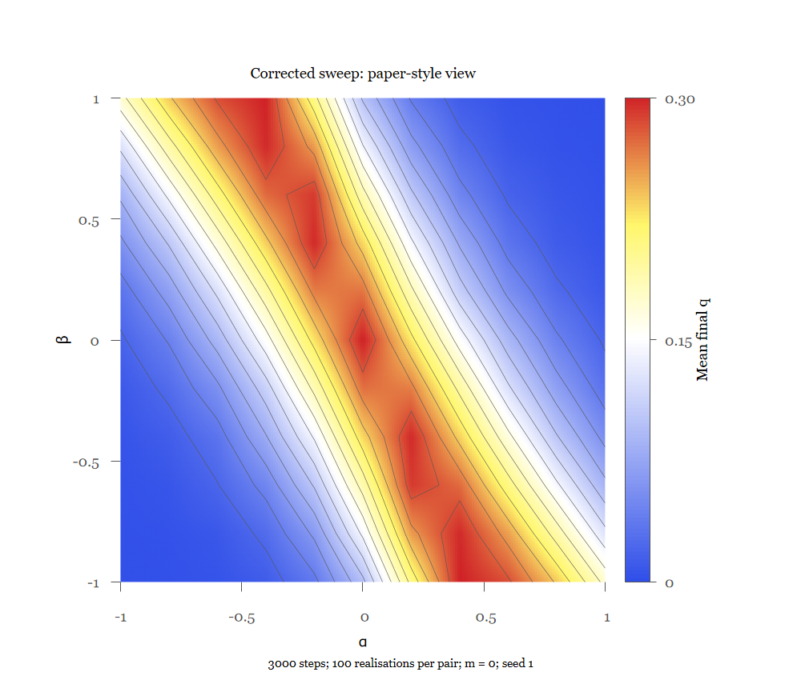
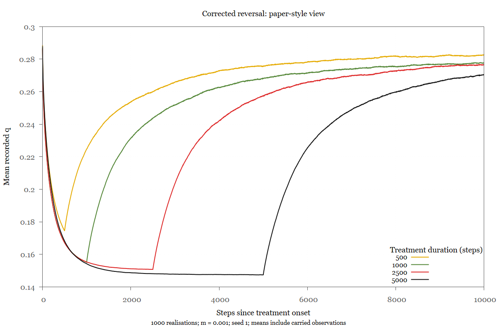
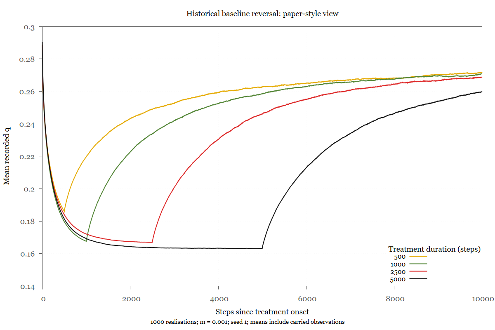
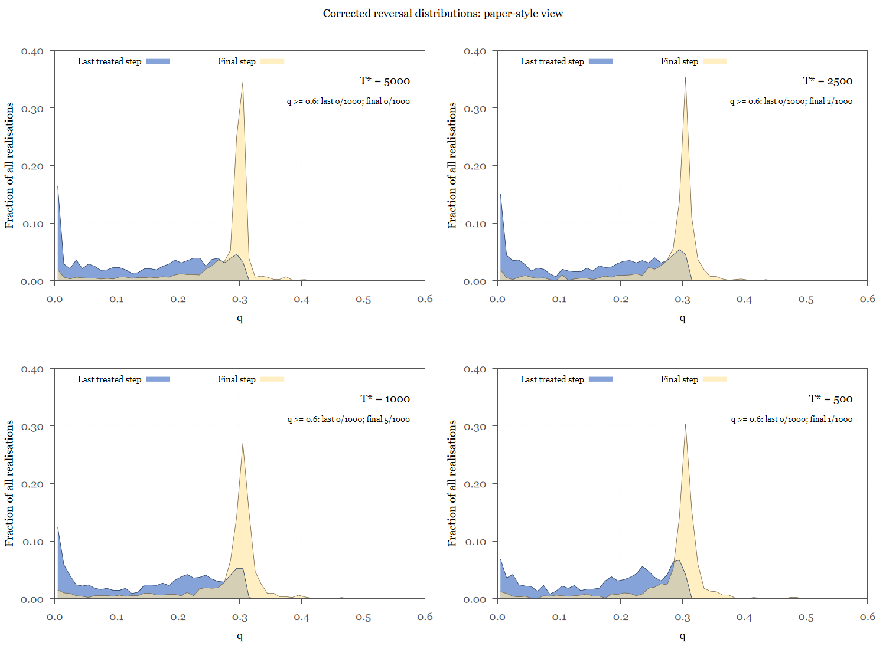
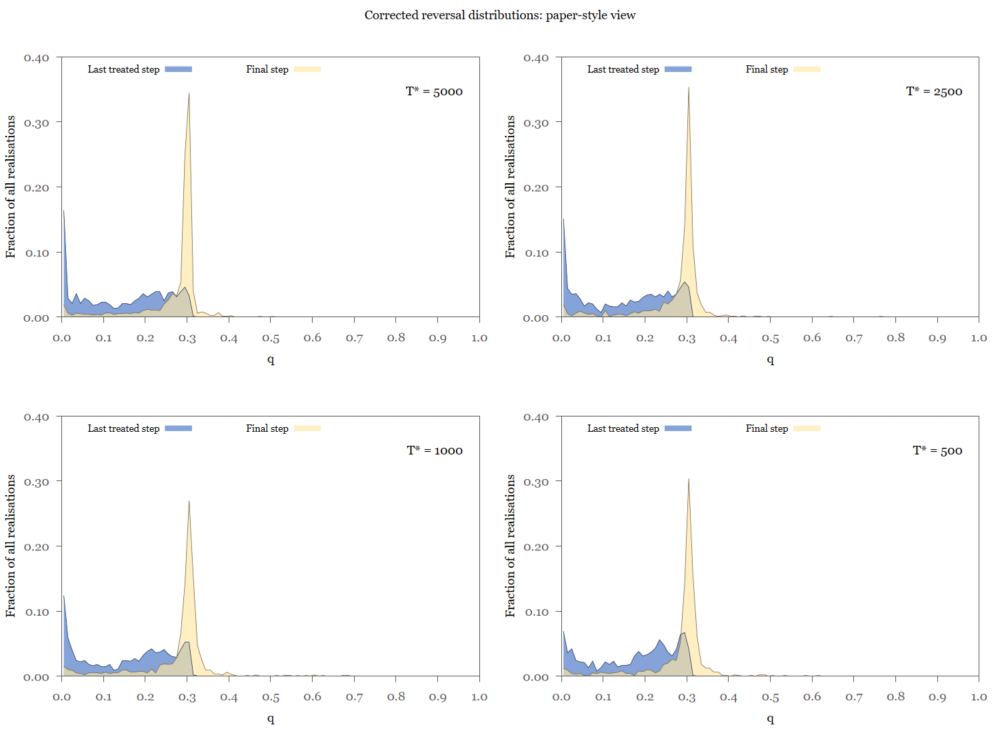

# Paper-style figures

This workflow follows the visual conventions of Figures 6–8 in the paper,
using the released rerun data. It does not reproduce the original published
images or silently substitute rerun values for archived observations.
Existing diagnostic audit figures remain separate.

## Generate

From the candidate repository root, with Gnuplot on PATH:

```bash
bash scripts/render-paper-figures.sh
```

Output defaults to `build/paper-figures/`. An optional directory may be supplied
as the only argument. The workflow verifies the released numerical data,
checks fixed display scales against those inputs, then produces PNG and SVG
versions of six figures. It records the renderer version and figure hashes.
It does not rerun any simulations or modify numerical result tables.

Requirements are Bash, AWK, standard GNU utilities and Gnuplot with pngcairo
and SVG support. The scripts target Gnuplot 5.4 or newer; actual renderer
compatibility must be confirmed on the release platforms. There is no Python
dependency. Generic serif fonts allow platform substitution; pixel-identical
text rendering is not promised.

## Figures and scientific definitions

| Output stem | Inputs and convention |
|---|---|
| `historical-sweep` | Historical baseline grid means; blue/white/yellow/red palette with contours, as in Figure 6. |
| `corrected-sweep` | Corrected grid means with the same colour scale and contour levels. |
| `historical-reversal-means` | Four historical ensemble means; gold, green, red and black correspond to durations 500, 1000, 2500 and 5000. |
| `corrected-reversal-means` | Four corrected means with the same colour and time conventions. |
| `corrected-reversal-distributions-paper-range` | Four panels ordered 5000, 2500, 1000, 500; blue treatment-end and beige final distributions, displaying q below 0.6. Excluded counts are printed in each panel. |
| `corrected-reversal-distributions-full` | The same distributions across the full probability range [0, 1]. |

### Sweep

The original 11 by 11 grid is preserved. Gnuplot bilinearly interpolates the
colour surface for visual presentation and overlays contours at increments
of 0.02. Intermediate colours are not additional simulations. Colour limits
are 0 to 0.3, verified to contain all released aggregate values. The grid
parameters are labelled alpha and beta using Greek characters.

### Mean reversal curves

Time is simulation step minus 5000. Treatment starts at elapsed time zero
and ends at elapsed time equal to the stated duration. All curves include
valid carried observations after extinction, following the recorded strict
mean convention. A curve therefore is not exclusively a mean over living
populations. The existing diagnostic figures show extinction-aware quantities
separately. The shared y limits [0.14, 0.30] contain all released curve values.

### Reversal distributions

Heights are bin counts divided by all 1000 realisations, using bins of width
0.01. Bin boundaries are lower-inclusive, except that q = 1 belongs in the
last bin. Connected shaded profiles at bin centres follow the paper's area
presentation; the ordinate is a fraction per bin, not a probability density.
Blue and beige profiles overlap; they are not stacked or subtracted.

Each panel compares the last treated step (T2 - 1) with final step 15000.
These are corrected reruns, not the original archived histograms. Means and
histograms include carried observations; those are historical susceptibility
observations rather than current living-population measurements. Consult
extinction-aware audit plots and the released snapshots for status categories.

The restricted view shows bins with lower bounds below 0.6 and states the
count outside that range (q >= 0.6). Its denominator remains 1000. The full
view includes all bins through q = 1. Both views use a common vertical scale
of 0 to 0.4, checked against all displayed bin fractions so peaks are not
clipped. Historical individual snapshots are not supplied, so this workflow
does not fabricate corresponding historical distribution panels.

## Verification status

Bash syntax, source-data integrity, grid ordering and all plotted numeric
ranges were checked during preparation. Gnuplot was unavailable in the
preparation environment, so actual Gnuplot execution and visual inspection
remain pending on the user's Windows installation and later in the release
container. Successful file creation alone is not visual verification.

After rendering, inspect the labels, contour map, curve colours, overlaid
profiles and excluded counts. If a plotting error occurs, retain the exact
message and do not commit partial figure outputs. Generated figures remain
under ignored `build/` until reviewed for inclusion in documentation.

## Rendered Figures

These figures were generated from the released result tables using
`scripts/render-paper-figures.sh`. They show historical baseline and corrected
reruns, rather than exact reproductions of the published figures.

### Antimicrobial Parameter Sweep




Colours interpolate the recorded 11 × 11 parameter grid. Contours are spaced
at intervals of 0.02 in mean final susceptibility. Interpolation adds no
simulation observations.

### Mean Reversal Trajectories





Means include carried observations from extinct realisations. Those values
represent the last observed susceptibility, not measurements of living populations.

### Corrected Reversal Distributions



Blue profiles show the last treated step; beige profiles show the final step.
Heights represent fractions of all 1000 realisations per bin of width 0.01,
including carried observations. Connected, shaded profiles follow the paper’s
visual convention; they are not fitted probability densities.

The restricted view reports observations outside its displayed range.
Fractions are not renormalised after restricting the display.


