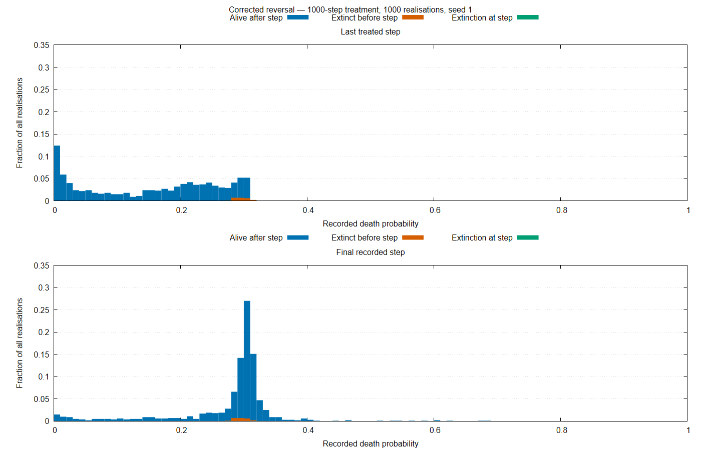

# Reversal Comparison — 1000-Step Treatment

## Corrected Run

- Source commit: 9845275c06ff1324f1f5d08c41ef9d9946afd148
- Seed: 1.
- Realisations: 1000.
- Total steps: 15000.
- Treatment interval: [5000, 6000).
- Runtime: 21162.323 seconds.
- Exit status: 0.
- Validation: output checksums and expected dimensions pass.
- Final survival: 977 realisations; 23 became extinct.

## Susceptibility Summary

| Step | Description | Mean including carried values | Survivor mean |
|---:|---|---:|---:|
| 5000 | Treatment onset | 0.286706761 | 0.286706761 |
| 5999 | Last treated step | 0.155171189 | 0.151856345 |
| 6000 | First untreated step | 0.155546012 | 0.152239992 |
| 15000 | Final observation | 0.277538088 | 0.277103939 |

No measurements are unavailable. All 23 extinctions occurred before the last treated step. Their subsequent values are carried historical observations, not measurements of living populations.

## Threshold Fractions

Denominator: all 1000 realisations, including valid carried values.

| Step | q <= 0.1 | q >= 0.27 |
|---:|---:|---:|
| 5999 | 36.0% | 17.6% |
| 6000 | 35.8% | 17.8% |
| 15000 | 6.4% | 77.8% |

## Interpretation

Mean susceptibility decreases during treatment and increases after withdrawal. Approximately 93% of the treatment-associated decrease in the ensemble mean is recovered by the final observation.

The final distribution is concentrated near $q = 0.3$, with a remaining low-susceptibility tail. Survivor-only means show a similar recovery pattern, so carry-forward does not explain the ensemble recovery.

These results are qualitatively consistent with resistance acquisition and substantial, but incomplete, reversal over the observed period. They do not establish permanent residual resistance.

Compared with the corrected 500-step run, this sample has lower treatment-end susceptibility and a larger final deficit relative to onset. Random histories differ, and the longer treatment leaves less time for recovery before the common final step.

The historical final-outcome comparison and preliminary uncertainty assessment are reported below. Crossing-time results are reported below.

## Historical Comparison and Preliminary Uncertainty

- Historical commit: fb82dd0ed027256c1dfe512314fa0a31dcdf06da
- Runtime: 5078.334 seconds.
- Exit status: 0.
- Output checksums and expected dimensions pass.

Both implementations used seed 1 and the same experiment settings.

| Final outcome | Historical | Corrected | Difference | Approximate 95% interval |
|---|---:|---:|---:|---|
| Mean q, including carried values | 0.270747257 | 0.277538088 | +0.006790831 | [−0.000401283, +0.013982945] |
| Survivor mean q | 0.271000683 | 0.277103939 | +0.006103255 | [−0.001733089, +0.013939600] |
| Zero final recorded population | 15.1% | 2.3% | −12.80 pp | [−15.27, −10.43] pp |
| q >= 0.27, all realisations | 70.6% | 77.8% | +7.20 pp | [+3.37, +11.01] pp |
| q <= 0.1, all realisations | 6.7% | 6.4% | −0.30 pp | [−2.49, +1.89] pp |
| q >= 0.27, survivors | 72.44% | 77.28% | +4.84 pp | [+0.86, +8.83] pp |
| q <= 0.1, survivors | 7.89% | 6.55% | −1.34 pp | [−3.78, +1.03] pp |

Differences are corrected minus historical. pp denotes percentage points.

The corrected implementation has fewer extinctions and a larger fraction above the final susceptibility threshold q >= 0.27. The differences in final mean susceptibility and the low-q fraction are less clearly resolved by this sample. Intervals containing zero do not establish equivalence.

Mean-difference intervals use a normal approximation with separate sample variances. Proportion differences use Newcombe intervals based on Wilson intervals. These assume independent ensembles;
possible dependence from the shared seed is not accounted for.

Survivor-conditioned comparisons concern different selected groups. Independent seed batches are needed to assess robustness.

## Acquisition and Reversal Times

First-crossing times were calculated from ensemble means including carried values. Each implementation uses its own onset-to-last-treated decrease as the reference amplitude.

| Fraction | Historical acquisition | Historical recovery | Corrected acquisition | Corrected recovery |
|---|---:|---:|---:|---:|
| 50% | 91 | 1205 | 91 | 735 |
| 90% | 497 | Not reached | 479 | 5721 |

Times are simulation steps since treatment onset or withdrawal, respectively. Historical 90% recovery was not reached within the observation window.

Corrected recovery takes approximately 8.1 times longer than acquisition at 50% and 11.9 times longer at 90%. These metrics support the paper's qualitative conclusion that reversal is slower than acquisition for this treatment duration.

These are ensemble first crossings, not individual-population recovery times or fitted rate constants. Crossing-time uncertainty and robustness across seeds remain unassessed.

The duration-generalised script also reproduced the existing 500-step crossing-time report exactly.

## Corrected-run Distributions

Bars show fractions of all 1000 realisations, separated by extinction status. Values recorded after extinction are carried-forward observations, not measurements of living populations. These panels show the corrected
run only.
