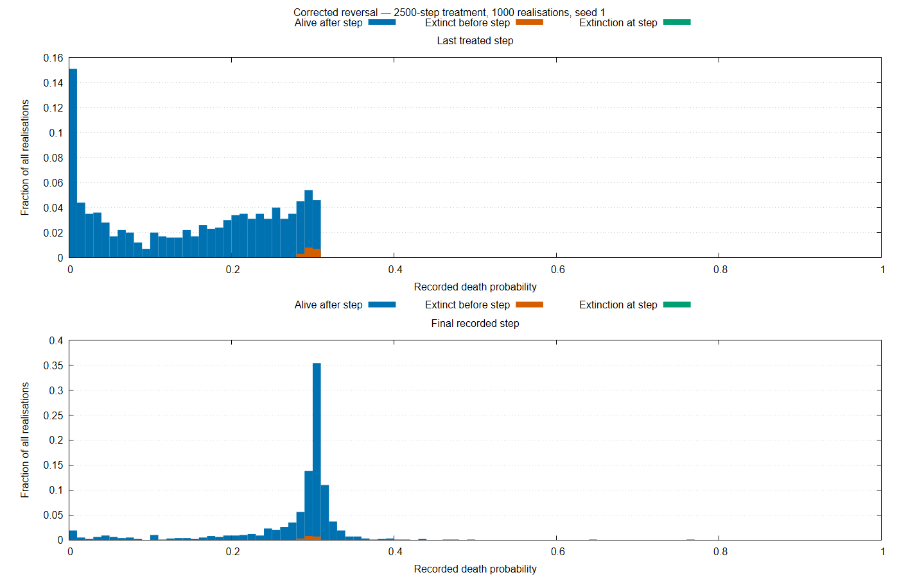

# Reversal Comparison — 2500-Step Treatment

## Corrected Run

- Source commit: 1c8fad7a8eb8b4809cc3f7dd8f84567df1640f7d
- Seed: 1.
- Realisations: 1000.
- Total steps: 15000.
- Treatment interval: [5000, 7500).
- Runtime: 8467.475 seconds.
- Exit status: 0.
- Validation: output checksums and expected dimensions pass.
- Final survival: 982 realisations; 18 became extinct.

## Susceptibility Summary

| Step | Description | Mean including carried values | Survivor mean |
|---:|---|---:|---:|
| 5000 | Treatment onset | 0.286448674 | 0.286448674 |
| 7499 | Last treated step | 0.150800531 | 0.148126731 |
| 7500 | First untreated step | 0.151124047 | 0.148456177 |
| 15000 | Final observation | 0.276451680 | 0.276081058 |

No measurements are unavailable. All 18 extinctions occurred before the last treated step. Subsequent values for those realisations are carried historical observations, not measurements of living populations.

## Threshold Fractions

Denominator: all 1000 realisations, including valid carried values.

| Step | q <= 0.1 | q >= 0.27 |
|---:|---:|---:|
| 7499 | 37.2% | 18.0% |
| 7500 | 37.0% | 18.0% |
| 15000 | 5.8% | 78.1% |

## Interpretation

Mean susceptibility decreases during treatment and rises after withdrawal. Approximately 92.6% of the treatment-associated decrease in the ensemble mean is recovered by the final observation.

The final distribution is concentrated near $q = 0.3$, with a remaining low-susceptibility tail. Survivor-only means show a similar recovery pattern, so carry-forward does not explain the ensemble recovery.

These findings are qualitatively consistent with resistance acquisition and substantial, but incomplete, reversal over the observed period. They do not establish permanent residual resistance or recovery within every individual realisation.

The snapshot plot uses different vertical scales for its two panels. Histogram bins cover [0, 1], and frequencies use all realisations as the denominator.

The matched historical comparison and crossing-time analysis are reported below.

## Historical Comparison and Preliminary Uncertainty

- Historical commit: fb82dd0ed027256c1dfe512314fa0a31dcdf06da
- Runtime: 8212.085 seconds.
- Exit status: 0.
- Output checksums and expected dimensions pass.

Both implementations used seed 1 and the same experiment settings.

| Final outcome | Historical | Corrected | Difference | Approximate 95% interval |
|---|---:|---:|---:|---|
| Mean q, including carried values | 0.268760631 | 0.276451680 | +0.007691049 | [+0.000807302, +0.014574796] |
| Survivor mean q | 0.268979780 | 0.276081058 | +0.007101278 | [−0.000545528, +0.014748083] |
| Zero final recorded population | 17.6% | 1.8% | −15.80 pp | [−18.37, −13.34] pp |
| q >= 0.27, all realisations | 68.0% | 78.1% | +10.10 pp | [+6.22, +13.94] pp |
| q <= 0.1, all realisations | 5.9% | 5.8% | −0.10 pp | [−2.18, +1.98] pp |
| q >= 0.27, survivors | 70.75% | 77.70% | +6.95 pp | [+2.90, +11.00] pp |
| q <= 0.1, survivors | 7.16% | 5.91% | −1.25 pp | [−3.62, +1.03] pp |

Differences are corrected minus historical. pp denotes percentage points.

The corrected run has fewer extinctions and a larger fraction with final $q \geq 0.27$, including among survivors. The survivor-mean difference and changes in the low-q fraction are less clearly resolved by this sample. Intervals containing zero do not establish equivalence.

Mean-difference intervals use a normal approximation with separate sample variances. Proportion differences use Newcombe intervals based on Wilson intervals. These assume independent ensembles;
possible dependence from the shared seed is not accounted for.

Survivor-conditioned comparisons concern different selected groups. The results reflect combined corrections. Robustness across independent seed batches remains unassessed.

## Acquisition and Reversal Times

First-crossing times use ensemble means including carried values. Each implementation uses its own onset-to-last-treated decrease as the reference amplitude.

| Fraction | Historical acquisition | Historical recovery | Corrected acquisition | Corrected recovery |
|---|---:|---:|---:|---:|
| 50% | 98 | 1375 | 100 | 759 |
| 90% | 627 | Not reached | 565 | 5545 |

Times are simulation steps since treatment onset or withdrawal, respectively. Historical 90% recovery was not reached within the observation window.

Corrected recovery takes approximately 7.6 times longer than acquisition at 50% and 9.8 times longer at 90%. These metrics support slower reversal than acquisition for this treatment duration.

Both implementations retain the qualitative acquisition-and-reversal pattern described in the paper, with quantitative differences. Crossing-time uncertainty remains unassessed. These ensemble first crossings are not individual-population recovery times or fitted rate constants.

## Corrected-run Distributions

Bars show fractions of all 1000 realisations, separated by extinction status. Values recorded after extinction are carried-forward observations, not measurements of living populations. These panels show the corrected
run only.
