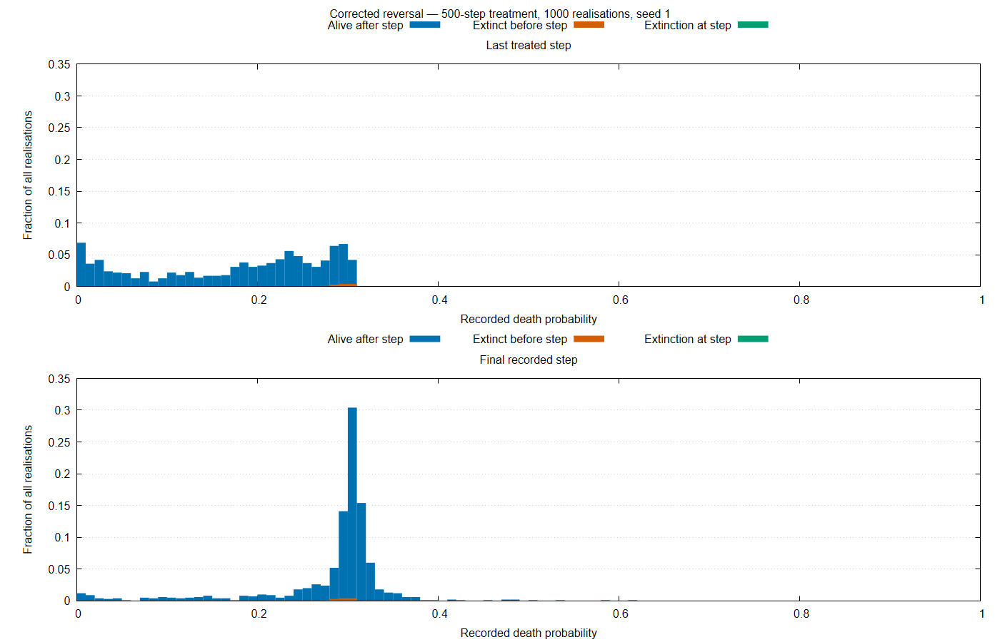

# Reversal Comparison — 500-Step Treatment

## Corrected Run

- Source commit: 37fa00ae9d5cd688686edd29005dc54126a47705
- Seed: 1.
- Realisations: 1000.
- Total steps: 15000.
- Treatment interval: [5000, 5500).
- Runtime: 10127.413 seconds.
- Exit status: 0.
- Validation: output checksums and expected dimensions pass.
- Final survival: 988 realisations; 12 became extinct.

## Susceptibility Summary

| Step | Description | Mean including carried values | Survivor mean |
|---:|---|---:|---:|
| 5000 | Treatment onset | 0.288537442 | 0.288537442 |
| 5499 | Last treated step | 0.174393972 | 0.172938106 |
| 5500 | First untreated step | 0.174796858 | 0.173345886 |
| 15000 | Final observation | 0.282588367 | 0.282446603 |

No measurements are unavailable. At each listed post-treatment-onset
snapshot, the 12 extinct realisations contribute carried-forward values.

## Threshold Fractions

Denominator: all 1000 realisations, including valid carried-forward
observations from extinct populations.

| Step | q <= 0.1 | q >= 0.27 |
|---:|---:|---:|
| 5499 | 27.1% | 21.5% |
| 5500 | 27.0% | 21.8% |
| 15000 | 4.8% | 80.4% |

## Interpretation

During treatment, selection favours resistance to the treatment: mean susceptibility decreases from 0.2885 at onset to 0.1744 at the last treated step.

After withdrawal, mean susceptibility rises to 0.2826 by the final observation. This corresponds descriptively to recovery of about 95% of the treatment-associated decrease in the ensemble mean.
It does not establish recovery within every individual realisation.

The fraction of realisations with $q <= 0.1$ decreases from 27.1% at treatment end to 4.8% at the final observation. At the final observation, 80.4% have q >= 0.27. These thresholds describe the population-averaged susceptibility within the model, not clinical resistance classifications.

Twelve realisations became extinct. Their carried-forward values are historical observations, not evidence of recovery. Survivor-only means show a similar recovery pattern, so the ensemble recovery is not explained by those carried values.

Following withdrawal, $q$ measures potential susceptibility to the withdrawn antimicrobial at its fixed reference concentration. The original environmental selection pressure remains active.

This run supports substantial reversal over the observed period, with residual resistance in part of the ensemble. Whether the remaining difference from initial susceptibility is systematic, whether recovery continues at longer times, and how corrections change the historical results remain unresolved.

For the 500-step treatment, the corrected results are qualitatively consistent with the paper's account of resistance acquisition during treatment and substantial, but incomplete, reversal over the observed post-treatment period. Nevertheless, this agreement does not establish quantitative reproduction or validate the conclusions for other treatment durations.

## Historical Comparison

The historical run used commit fb82dd0ed027256c1dfe512314fa0a31dcdf06da, seed 1 and the same
simulation settings as the corrected run.

- Runtime: 8590.475 seconds.
- Exit status: 0.
- Output checksums and expected dimensions pass.
- Final recorded populations: 850 positive and 150 zero.

| Measure | Historical | Corrected |
|---|---:|---:|
| Onset mean q | 0.288447011 | 0.288537442 |
| Last treated mean q | 0.186018154 | 0.174393972 |
| Final mean q, including carried values | 0.271479356 | 0.282588367 |
| Final survivor mean q | 0.272630353 | 0.282446603 |
| Final q <= 0.1, among survivors | 7.41% | 4.86% |
| Final q >= 0.27, among survivors | 72.35% | 80.16% |
| Zero final recorded population | 15.0% | 1.2% |

For this sample and treatment duration, the corrected implementation shows a larger decrease in ensemble-mean susceptibility during treatment, higher final susceptibility and fewer extinctions.

The final susceptibility difference persists among surviving realisations, so it is not solely a consequence of carrying historical measurements forward after extinction. Survivor-conditioned results
refer to different selected groups in the two implementations.

Both implementations show resistance acquisition followed by substantial reversal over the observed period, qualitatively consistent with the paper. Quantitative differences are present. Their uncertainty,
robustness across seeds and dependence on treatment duration remain to be assessed.

Identical seeds do not pair realisations across implementations. These comparisons reflect the combined corrections and do not identify the contribution of each correction separately.

## Preliminary Monte Carlo Uncertainty

Approximate unpaired 95% intervals were calculated across realisations.

| Final outcome | Corrected minus historical | Approximate 95% interval |
|---|---:|---:|
| Mean q, including carried values | +0.011109 | [+0.004175, +0.018043] |
| Mean q among survivors | +0.009816 | [+0.002198, +0.017435] |
| Extinction fraction | −13.80 percentage points | [−16.20, −11.54] |
| q >= 0.27, all realisations | +11.00 percentage points | [+7.21, +14.75] |
| q <= 0.1, all realisations | −1.50 percentage points | [−3.54, +0.52] |

Mean-difference intervals use a normal approximation with separate sample variances. Proportion-difference intervals use the Newcombe method based on Wilson intervals.

The estimates indicate substantial quantitative differences, particularly in extinction and final susceptibility. The reduction in the low-$q$ fraction across all realisations is less clearly
resolved by this sample.

These calculations assume independent ensembles. Both runs used seed 1, so possible cross-implementation dependence is not accounted for. Independent seed batches are needed to assess robustness. The intervals quantify Monte Carlo variation, not model uncertainty.

Survivor-conditioned comparisons concern different selected groups and do not isolate a causal effect among matched populations.

## Acquisition and Reversal Times

Crossing times were calculated from ensemble means including carried-forward observations. For each implementation, the reference amplitude is the decrease from treatment onset to the last treated step.

Acquisition crosses a specified fraction of that decrease. Recovery crosses the same fraction upward from the last-treated mean toward the onset mean.

| Fraction | Historical acquisition | Historical recovery | Corrected acquisition | Corrected recovery |
|---|---:|---:|---:|---:|
| 50% | 68 | 1135 | 82 | 641 |
| 90% | 327 | Not reached | 335 | 4973 |

Times are measured in simulation steps since treatment onset or withdrawal, respectively. They are first crossings, not sustained crossings or fitted rate constants.

In the corrected run, recovery takes approximately 7.8 times longer than acquisition at the 50% threshold and 14.8 times longer at 90%. The qualitative conclusion that reversal is slower than acquisition is therefore supported for this treatment duration and these metrics.

Each implementation uses its own treatment-associated amplitude. These results describe ensemble means, not individual-realisation recovery times. Crossing-time uncertainty and robustness across seeds and treatment durations remain unassessed.

## Corrected-run Distributions

Bars show fractions of all 1000 realisations, separated by extinction status. Values recorded after extinction are carried-forward observations, not measurements of living populations. These panels show the corrected
run only.

## Within-realisation Susceptibility Recovery

Among the 988 final survivors, 627 (63.46%) ended with $q$ above their own first recorded treatment-step value, 360 (36.44%) ended below it, and one was equal at output precision. No measurements were unavailable.

The mean final-minus-onset difference among these survivors was −0.005947525. Thus, a majority showed increased susceptibility relative to their own recorded onset value, while the survivor ensemble mean
remained below its corresponding onset mean.

The onset observation is measured after the first treatment step’s life-cycle and death events. This comparison therefore establishes overshoot relative to recorded onset susceptibility, rather than
relative to a directly measured pre-treatment baseline. Differences are evaluated at the six-decimal precision of qav.txt.
