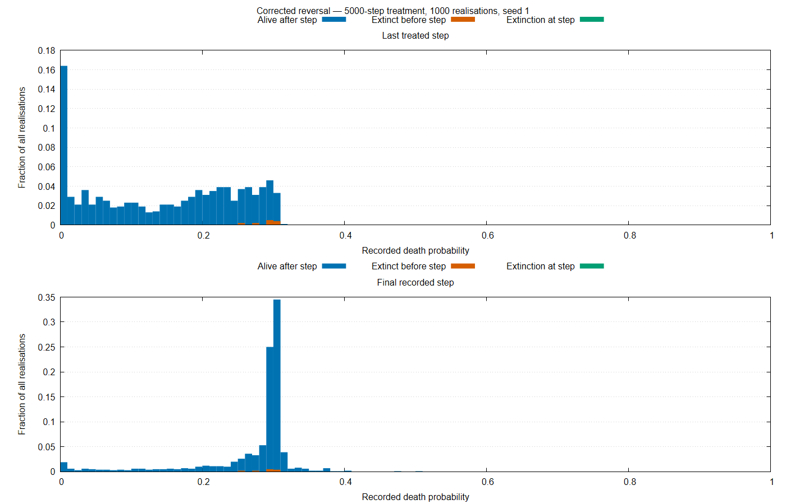

# Reversal Comparison — 5000-step Treatment

## Corrected Run

- Source commit: `425fb60da951d98d8da71c82b7cf0782766973f9`
- Seed: 1; realisations: 1000; total steps: 15000.
- Treatment interval: [5000, 10000); runtime: 12447.543 seconds.
- Exit status: 0. Output checksums, dimensions and extinction records passed validation.
- Final survival: 987 realisations; 13 became extinct before the last treated step.

| Step | Observation | Mean q including carried values | Survivor mean q |
|---:|---|---:|---:|
| 5000 | Treatment onset | 0.287842825 | 0.287842825 |
| 9999 | Last treated step | 0.147423812 | 0.145551161 |
| 10000 | First untreated step | 0.147730835 | 0.145862228 |
| 15000 | Final observation | 0.270466461 | 0.270214433 |

| Step | All: q ≤ 0.1 | All: q ≥ 0.27 | Survivors: q ≤ 0.1 | Survivors: q ≥ 0.27 |
|---:|---:|---:|---:|---:|
| 9999 | 38.50% | 15.00% | 39.01% | 14.08% |
| 10000 | 38.50% | 15.10% | 39.01% | 14.18% |
| 15000 | 5.70% | 75.70% | 5.78% | 75.58% |

All three snapshots contain 1000 available values, including 13 carried-forward observations from extinct realisations. Survivor percentages use the 987 populations alive after each snapshot step.

By step 15000, the ensemble mean had recovered 87.6% of its treatment-associated decline. The survivor mean shows a similar rebound, and all 57 final observations with $q ≤ 0.1$ came from living populations. This supports substantial but incomplete reversal over the observed
period. The matched historical comparison and first-crossing analysis are reported below.

## Matched Historical Comparison

- Source commit: `fb82dd0ed027256c1dfe512314fa0a31dcdf06da`
- Runtime: 8778.183 seconds; exit status: 0.
- Output checksums and dimensions passed. Final recorded population
  was positive in 864 realisations and zero in 136.

| Final outcome | Historical | Corrected | Difference (corrected − historical) | Approx. 95% interval |
|---|---:|---:|---:|---:|
| Mean q, including carried values | 0.259840 | 0.270466 | +0.010626 | [0.003984, 0.017269] |
| Mean q among survivors | 0.259217 | 0.270214 | +0.010998 | [0.003808, 0.018187] |
| Zero final recorded population | 13.60% | 1.30% | −12.30 pp | [−14.63, −10.11] pp |
| q ≥ 0.27, all realisations | 65.90% | 75.70% | +9.80 pp | [5.82, 13.74] pp |
| q ≤ 0.1, all realisations | 6.40% | 5.70% | −0.70 pp | [−2.82, 1.41] pp |
| q ≥ 0.27, survivors | 67.94% | 75.58% | +7.64 pp | [3.54, 11.74] pp |
| q ≤ 0.1, survivors | 7.41% | 5.78% | −1.63 pp | [−3.96, 0.63] pp |

Intervals use the independent-ensemble approximation. They describe sampling uncertainty for this comparison; robustness across seeds was not assessed. Survivor summaries describe the populations that survived under each implementation, whose survival rates differed. The intervals for the low-susceptibility fractions include zero.

## Acquisition and Recovery Times

First crossings are measured from treatment onset for acquisition and from withdrawal for recovery. Each implementation uses its own treatment-associated decline in ensemble mean $q$, including carried values. Crossing-time uncertainty was not estimated.

| Threshold | Historical acquisition | Historical recovery | Corrected acquisition | Corrected recovery |
|---|---:|---:|---:|---:|
| 50% | 104 | 1,572 | 125 | 822 |
| 90% | 644 | Not reached | 654 | Not reached |

By the final observation, the historical ensemble mean had recovered 76.0% of its treatment-associated decline, compared with 87.6% for the corrected ensemble. Both runs support slower recovery than acquisition at the 50% threshold. Neither reached 90% recovery within the 5000 steps after withdrawal. The remaining deficit establishes incomplete
recovery over that window. Its persistence beyond the window is unknown.

## Corrected-run Distributions

Bars show fractions of all 1000 realisations, separated by extinction status. Values recorded after extinction are carried-forward observations, not measurements of living populations. The panels use independently scaled vertical axes and show the corrected run only.
