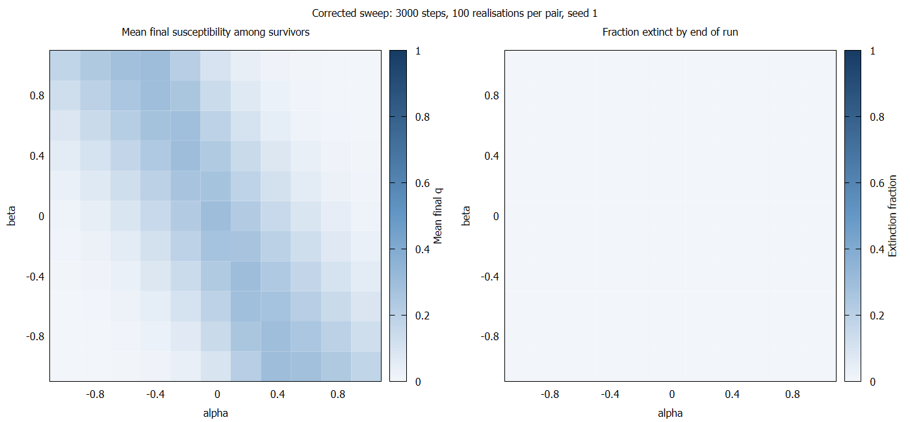
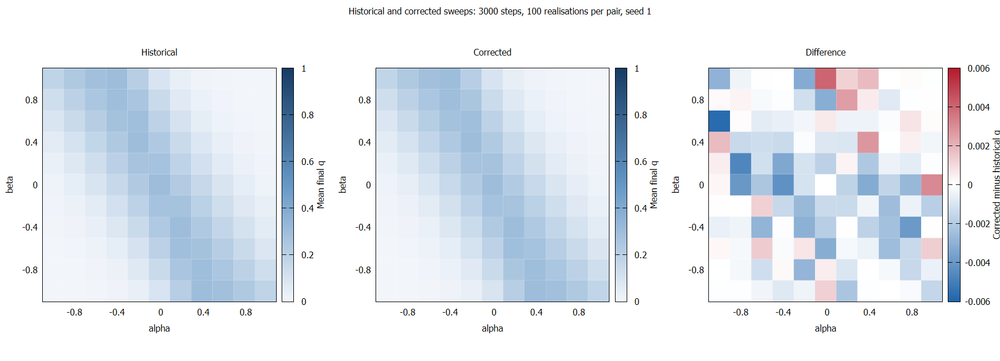

# Antimicrobial Parameter Sweep Comparison

## Runs and Validation

Both implementations used 3000 steps, 100 realisations per parameter pair, seed 1 and 121 parameter combinations. Both archived run sources set the mutation rate to m = 0, matching the mutation setting stated for Figure 6 of the paper.

| Implementation | Run directory | Source commit | Runtime (seconds) |
|---|---|---|---:|

Both runs exited successfully and passed output checksum verification. All 121 aggregate parameter pairs matched between implementations and contained valid probabilities.

The corrected run recorded 12100 surviving realisations, no extinctions and no unavailable measurements. Its individual extinction records agreed with the per-realisation outcomes, and reconstructed means matched
asymdrug.txt within printed precision.

Historical output contains aggregate susceptibility only. Historical extinction rates cannot be established from this output.

## Numerical Comparison

Differences are corrected minus historical, calculated from the six-decimal aggregate outputs.

| Quantity | Value |
|---|---:|
| Mean difference across the grid | −0.000742620 |
| Mean absolute difference | 0.001203645 |
| Largest absolute difference | 0.005804000 |
| Location of largest difference | alpha = −1, beta = 0.6 |
| Signed difference at that location | −0.005804000 |
| Cells with higher corrected q | 30 |
| Cells with lower corrected q | 90 |
| Cells equal at printed precision | 1 |

## Figures

All 12100 corrected realisations survived, so the extinction panel is uniformly zero and the survivor means equal the all-realisation means.

The first two panels share a colour scale from 0 to 1. The difference panel shows corrected minus historical q on a separate scale from −0.006 to 0.006. Blue denotes lower corrected susceptibility; red denotes higher corrected susceptibility.

## Interpretation and Limitations

The broad diagonal band of higher final susceptibility and the regions of lower susceptibility are visually preserved after correction. Corrected final $q$ is slightly lower in most grid cells, indicating
greater resistance under the model exposure in those cells.

The differences are small on the absolute probability scale. Sampling uncertainty was not estimated, so these results do not establish statistical equivalence or distinguish every observed difference from
Monte Carlo variation. Robustness across seeds remains unassessed.

This comparison supports qualitative agreement between the historical baseline and corrected implementation for the tested sweep. Exact agreement with the published figure remains a separate provenance check.
